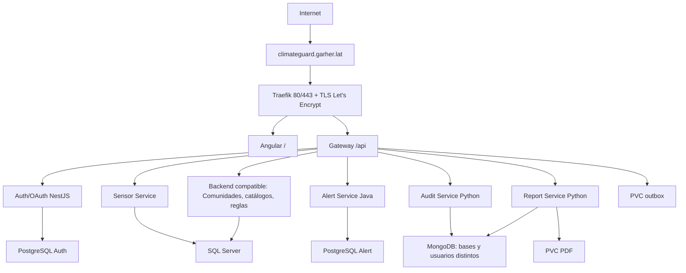

# ClimateGuard en AWS/K3s — candidato preparado, sin despliegue AWS

> Instrucción posterior para la presentación de 24 horas: reutilizar la EC2
> `i-REPLACE_INSTANCE_ID` **m7i-flex.large**, sin cambiar plan/tipo ni instalar
> K3s todavía. Seguir [el perfil y diagnóstico demo24](demo24/README.md).
> La propuesta de 16 GiB de este documento queda como alternativa anterior,
> no como autorización vigente.

Fecha: 6 de noviembre de 2026, Guatemala. Se preparó la publicación del trabajo local actual; **no se migró AWS ni se retiró el despliegue anterior**. La aprobación de retirada y los cambios de capacidad siguen pendientes. No hay permiso implícito para eliminar datos por aprobar este documento.

## Arquitectura recomendada

Una EC2 **x86-64 t3a.xlarge, 4 vCPU y 16 GiB**, Linux, K3s nativo de un servidor. Crear preferentemente una EC2 de reemplazo: permite probar sin cambiar el servidor viejo y revertir el dominio/IP. Root gp3 nuevo 32 GB y volumen gp3 cifrado separado de 160 GB para datos nuevos. Alternativa con menos provisión de infraestructura: ampliar la instancia actual y añadir el volumen, con parada y mantenimiento aprobados. No se eligió Graviton: SQL Server en contenedores requiere x86-64. No usar Spot para la única máquina con bases.

El perfil compatible publica todas las funciones locales sin sustituir contratos: **8 Deployments**, **4 StatefulSets**, **12 Services**, 7 Jobs de provisión/migración y 1 Job de diagnóstico. No crear Pods sueltos: Deployments, StatefulSets y Jobs los gestionan. Comunidades funciona dentro de `legacy-api`; la novena imagen `community-service` queda construida pero inactiva. Su activación exige resolver `sensorCount`, asociaciones y separación de datos. Compartir SQL entre Legacy y Sensor conserva el código actual, pero es una deuda de independencia de microservicios.

Este diseño reduce costos, pero NO es alta disponibilidad: una caída de EC2/AZ interrumpe todo. Los PVC locales no se trasladan automáticamente a otro nodo. Para HA real hacen falta varios nodos/control planes y almacenamiento/bases adecuados, con otro presupuesto. No se incluye HPA inicialmente: Gateway/outbox, Report/PDF y Auth mantienen una réplica y `Recreate`. Dos réplicas en un nodo no resuelven ese punto de fallo.

## Capacidad y costo

Datos del servidor actual **aportados por el usuario**, sin inspección autenticada: 2 vCPU, 7.6 GiB visibles, EBS 64 GiB. No hay AWS CLI ni alias SSH disponible en esta sesión. El DNS público resolvió `PREVIOUS_EC2_PUBLIC_IP`; el rango público oficial de AWS lo sitúa en EC2 **us-east-2**. Esto no verifica cuenta, ID de instancia, tipo, uso libre de disco ni configuración. HTTPS de `/` y `/api/auth/oauth/status` terminó con `ECONNRESET`; no se modificó ni diagnosticó como fallo de la aplicación.

El perfil solicita 5024 MiB y permite hasta 11904 MiB, excluyendo sistema/control plane. Proponer unos 2 GiB adicionales para SO/K3s/Ingress/cert-manager y margen de arranque. En 16 GiB cabe este presupuesto inicial; requiere carga real y observar memoria/CPU/latencia. Los 2 vCPU/7.6 GiB no están demostrados inviables para carga mínima, pero no son una base fiable para arrancar y actualizar simultáneamente todo el conjunto. No bajar requests para aparentar que cabe.

PVC: Auth PG 20 GiB + Alert PG 20 + Mongo 20 + SQL 40 + PDF 10 + outbox 2 = **112 GiB**. El EBS actual de 64 no alcanza. Un volumen nuevo de 160 deja unos 48 GiB nominales antes del overhead; root separado para SO/imágenes. `local-path` no aplica cuotas de capacidad: vigilar ocupación real y alertar al 70/80%; `Retain` evita reclamación automática, no sustituye backup. La ubicación nueva debe estar montada por UUID antes de iniciar K3s; verificar con `findmnt`, no ejecutar `mkfs` sobre dispositivos inferidos.

Estimación de referencia Linux On-Demand, 730 h/mes, **us-east-1**; confirmar precios de Ohio y región real antes de contratar:

| Opción | EC2/mes | EBS/mes a $0.08/GB | IPv4/mes | Subtotal |
|---|---:|---:|---:|---:|
| Reemplazo t3a.xlarge, root 32 + datos 160 GB | $109.79 | $15.36 | $3.65 | **$128.80** |
| Ampliar actual a t3a.xlarge, root 64 + datos 160 GB | $109.79 | $17.92 | $3.65 | $131.36 |
| Reemplazo t3.xlarge, root 32 + datos 160 GB | $121.91 | $15.36 | $3.65 | $140.92 |

Reservar otros $5–15/mes para backups según tamaño/retención: presupuesto orientativo del reemplazo **$134–144/mes**, antes de impuestos, egreso, CPU extra, dominio y retención del entorno viejo. Una referencia equivalente de 8 GiB t3a.large con root64+datos160 cuesta $76.47, pero no se recomienda para este conjunto sin prueba completa de carga. No asumir que la EC2 actual sea ese tipo ni que su factura sea esa cifra. Las T3/T3a usan créditos: observar `CPUCreditBalance`/surplus y evaluar una familia sin créditos si hay carga sostenida. No construir imágenes en EC2.

K3s evita la tarifa de control plane EKS; se usa Traefik/ServiceLB en 80/443 sin ALB ni NAT Gateway dedicados. No se promete que sea la opción más barata entre todas las ofertas: es la alternativa económica propuesta que conserva la pila actual y margen de memoria.

Fuentes de precios y arquitectura: [EC2 T3/T3a](https://aws.amazon.com/ec2/instance-types/t3/), [EBS](https://aws.amazon.com/ebs/pricing/), [IPv4](https://aws.amazon.com/vpc/pricing/), [rangos públicos](https://ip-ranges.amazonaws.com/ip-ranges.json), [SQL Server x86-64](https://learn.microsoft.com/en-us/sql/linux/containers/deploy?view=sql-server-ver17). Tarifas y exclusiones estructuradas en `cost-estimate.json`.

## Imágenes y paquete preparado

Se construyeron **las nueve imágenes** Linux/amd64 con tag `release-20261106-f0048fcb2ff2`; no se publicaron. `release-lock.json` registra imagen, ID/digest local, usuario, Dockerfile y hashes del código relevante, incluido código no confirmado. HEAD por sí solo no representa la release. La huella excluye secretos, appsettings y artefactos generados; no sustituye un respaldo íntegro del repositorio. El build utilizó la caché existente cuando correspondía. Un digest local presente en Docker no demuestra que exista en un registro remoto.

Las imágenes de bases quedaron fijadas por digest consultado al registro oficial en `database-images.json`. No se ejecutaron bases nuevas. Las aplicaciones se renderizaron con `imagePullPolicy: Never`: importar las imágenes exactas al containerd de EC2 mediante archivo OCI/Docker y comprobar su identidad. Esto permite distribuir sin commits ni push de Git o de imágenes. Un futuro registro privado requiere autorización y adaptar referencias/pull credentials.

Archivos generados en `candidate/`:

1. `00-platform.yaml`: namespace, StorageClass `cg-retain`, PVC, ConfigMaps, Services y NetworkPolicies.
2. `01-databases.yaml`: cuatro StatefulSets nuevos.
3. `02-job-config.yaml` y `job-*.yaml`: scripts y siete Jobs separados.
4. `03-applications.yaml`: ocho Deployments con probes, recursos y Secrets referenciados.
5. `04-issuer.yaml`: Issuer ACME de cert-manager; sin valores privados.
6. `05-ingress.yaml`: hostname definitivo, TLS y rutas `/api` hacia Gateway y `/` hacia Angular.
7. `06-internal-probe.yaml`: ocho resoluciones DNS y ocho readiness HTTP reales cuando se ejecute.
8. `07-http-redirect.yaml`: Ingress HTTP y Middleware Traefik de redirección HTTPS; el challenge ACME usa su ruta específica aparte.

`complete.yaml` NO es el comando de instalación: no aplicarlo de una sola vez. Los permisos/secretos/migraciones requieren etapas. `prepare.py` valida core APIs con OpenAPI 1.36.1 offline; la validación del Issuer y compatibilidad de cert-manager se debe realizar con sus CRDs instalados, mediante dry-run del servidor.

`prepare-release.cjs` permite reconstruir localmente, sin publicar. Para volver a renderizar usar la imagen auxiliar existente montando solo `infrastructure/k8s`, el release-lock público y una carpeta de salida; ejecutar `python aws/prepare.py --output ... --release-lock ... --swagger ...`. No montar dotenv, kubeconfig ni socket Docker en ese validador. `candidate/release-lock.json` corresponde a esta construcción, no a futuros cambios.

## Secrets, datos nuevos y migraciones

No hay valores Secret en este paquete ni se accedió a dotenv. La lista base está en `../secrets/required-keys.json`; excluir los dos Secrets Community del perfil inactivo. TLS y `letsencrypt-account` los debe crear cert-manager. Para este candidato se añade `sql-app-bootstrap` con `username/password`, coincidentes con `sql-app/connection-string`; nunca usar SA para las aplicaciones.

Crear claves JWT access/refresh independientes, HMAC Gateway/Audit y sesión OAuth nuevas. Crear usuarios PG/Mongo de mínimo privilegio, credenciales raíz nuevas y un administrador inicial privado. Provisionar por stdin/archivos privados con permisos 0600, no `--from-literal`, argumentos, Git o salida de terminal. Usar `create`, no sobreescribir identidades existentes; conservar claves en gestor privado para restauración. K3s debe cifrar Secrets en reposo; RBAC y acceso privado al kubeconfig siguen siendo necesarios. IMDSv2, rol IAM mínimo, EBS cifrado y copias externas cifradas se revisan antes de publicar.

Orden obligatorio: bases Ready → `provision-auth-db`, `provision-alert-db`, `provision-mongo` → `sql-empty-schema` → `provision-sql-app` → `auth-migrate` → `auth-bootstrap-admin`. Ejecutar secuencialmente, esperar Complete y guardar solo estado sanitizado. El Job SQL añadido rechaza identidades existentes, usa variables de entorno validadas y no imprime contraseñas; está preparado y validado sintácticamente, **no ejecutado contra SQL**. Auth usa sus cuatro migraciones compiladas. Alert ejecuta Flyway V1/V2 al arrancar; detenerse ante errores, no `repair` automático.

El DDL SQL crea estructura vacía, no catálogos. **Falta un conjunto autorizado de SensorTypes, AlertSeverities y reglas**, con IDs/unidades coherentes. No copiar toda la base vieja ni inventar lecturas para llenar PDFs. Propuesta: exportación explícita revisada de catálogos válidos o fixture académico aprobado; generar un Job independiente después de aprobar esos datos. Sin esto no dar por aprobado el recorrido sensor→evaluación→alerta ni las pantallas dependientes de catálogos. Mantener los datos viejos intactos, sin adopción de sus volúmenes.

SQL actual usa `MSSQL_PID=Developer`: apto para desarrollo/pruebas, **no afirmar uso comercial de producción autorizado**. Si el sitio deja de ser una demostración académica, seleccionar edición/licencia válida antes de publicar; Express puede ser alternativa gratuita solo tras revisar límites y compatibilidad. No cambiarla silenciosamente.

## Ejecución posterior y aprobación

Ver `EXECUTION.md` para las acciones, validaciones y alcance de retirada. No hay script automático que pare el servidor anterior, cambie DNS o borre datos. La aprobación debe identificar recursos reales después del inventario. Hasta entonces, el alcance de eliminación aprobado es **cero**.

## Estado de pruebas y requisitos

En esta preparación: nueve builds PASS; 16 comprobaciones HTTP aisladas PASS; generación de PDF técnico real PASS; seis comprobaciones Auth compilado PASS; 15 pruebas de seguridad de manifiestos PASS. Las readiness sin SQL/Mongo devolvieron 503 esperado: no confundir con readiness productiva aprobada. No se repitieron todos los tests de negocio previamente aprobados porque no cambió su código. No se ejecutó E2E en AWS ni se probaron certificados o restauraciones.

La prueba K3s local previa solo verificó nodo/CoreDNS Ready y Services del sistema; se detuvo por RAM Windows, antes del despliegue completo. No demostraría que toda la aplicación funciona en Kubernetes. `e2e.cjs` e `internal-probe.cjs` están preparados, sin ejecutarse contra AWS.

La fuente enlazada del curso no contiene una rúbrica titulada «ocho requisitos»: pide Compose en Fase 3 y preparación Kubernetes; enumera ocho tipos de reporte y además historial/descarga. Hasta recibir la rúbrica exacta, no declarar ocho de ocho. [Especificación consultada](https://github.com/melgust/desaweb2026b/blob/main/phase_3.md).

| Punto de revisión | Estado real del trabajo local |
|---|---|
| Gateway y entrada única | Preparado para dominio/TLS; falta E2E AWS |
| Auth/JWT/OAuth | Implementado local; faltan clientes/callbacks HTTPS y prueba interactiva |
| Comunidades/Sensores | Funcionales compatibles; separación Community/PostgreSQL pendiente |
| Alertas/Auditoría | Implementadas; faltan catálogos nuevos, entrega/reintento y durabilidad en AWS |
| Lenguajes/gestores | C#, TypeScript, Java, Python; SQL Server, PostgreSQL, MongoDB |
| PDF/dashboard/historial | Comunidades, sensores y lecturas; cinco tipos adicionales pendientes |
| VPS HTTPS/orquestación | K3s propuesto; no sustituye automáticamente evidencia Compose exigida |
| Contenedores/persistencia | Preparados; faltan despliegue completo, carga y restauración |

También permanecen los avisos de dependencias documentados en `../REVIEW-20261106.md`, la política de forwarded headers/rate limiting tras Ingress y la comprobación de permisos de reportes: el servicio usa rol Administrador, sin exigir explícitamente cada capability JWT. Resolver o aceptar de forma documentada antes de declarar una release productiva.
